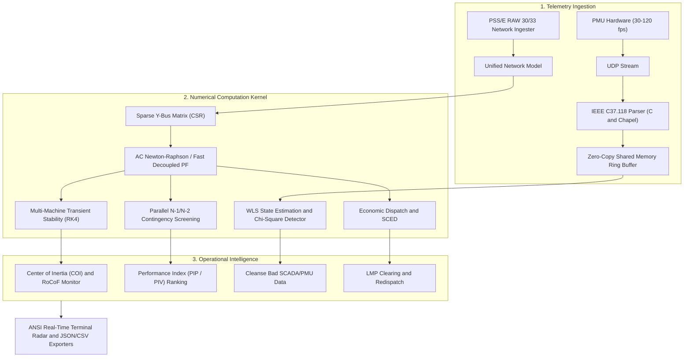

# Phasor

[](#)
[](https://chapel-lang.org/)
[](#)
[](#)
[](LICENSE)

Phasor is a high-throughput distributed energy management system (EMS), synchrophasor telemetry processor, and dynamic power grid stability kernel. Built from the ground up in Chapel with C hardware acceleration and Python telemetry tooling, Phasor provides mission-critical operational intelligence for electrical power transmission networks.

```
+======================================================================================================+
|                                  PHASOR ENERGY MANAGEMENT SYSTEM                                     |
|  IEEE C37.118 PDC  *  AC State Estimation  *  Parallel Contingency  *  Transient Dynamics (RK4)     |
+======================================================================================================+
```

---

## Architecture Overview

Phasor combines Chapel's task-parallel and distributed multi-locale architecture with cache-optimized sparse linear algebra to evaluate bulk power grid security in real time.



---

## Key Capabilities

### 1. Multi-Engine AC and DC Power Flow
- **AC Newton-Raphson Solver**: Full non-linear polar formulation with exact analytical Jacobian sub-blocks ($J_{11}, J_{12}, J_{21}, J_{22}$) and automatic PV-PQ generator capability switching.
- **Fast-Decoupled Load Flow (FDF)**: Stott-Alsac decoupled formulation factorizing constant $B'$ and $B''$ matrices via Cholesky decomposition, reducing iteration step time by 4x.
- **Linearized DC Power Flow**: Fast $O(N)$ active power approximation for sensitivity analysis and market clearing studies.

### 2. AC State Estimation and Bad Data Processing
- **Gauss-Newton Weighted Least Squares (WLS)**: Fuses conventional SCADA measurements (voltage magnitudes, active/reactive branch flows, bus injections) with high-speed PMU voltage/current phasors.
- **Global Chi-Square ($\chi^2$) Detection**: Verifies measurement residual sum of squares against the theoretical distribution for $K$ degrees of freedom.
- **Largest Normalized Residual ($r_N$) Identification**: Computes diagonal entries of the residual covariance matrix $\Omega = R - H G^{-1} H^T$ to locate and reject corrupt telemetry with $> 13\sigma$ confidence.

### 3. Massively Parallel Contingency Screening
- **Multi-Core Task Distribution**: Leverages Chapel's `forall` runtime to distribute thousands of transmission line and generator outages across all CPU cores.
- **Sherman-Morrison Low-Rank Updates**: Evaluates branch outages in $O(N)$ operations via rank-1 admittance updates without matrix re-factorization.
- **Security Ranking**: Evaluates composite Active Power Overload ($PI_P$), Voltage Security ($PI_V$), and Kessel-Glavitsch Proximity to Voltage Collapse ($L$-index).

### 4. Electromechanical Dynamic Transient Stability
- **Multi-Machine Swing Equations**: Solves non-linear generator rotor angle ($\delta$) and speed ($\omega$) differential equations under 3-phase fault conditions.
- **Explicit 4th-Order Runge-Kutta (RK4)**: 1-millisecond integration time-steps with adaptive fault inception and clearing logic.
- **Center of Inertia (COI) Tracking**: Real-time inertial center tracking, frequency nadir identification, and Rate of Change of Frequency (RoCoF) calculation.

### 5. Telemetry Protocols and Zero-Copy Bridge
- **IEEE C37.118-2011 Encoder/Decoder**: Binary frame parsing for Data, Header, Config 1/2/3, and Command frames with table-accelerated 16-bit CRC-CCITT (0x1021).
- **IEEE C37.111 COMTRADE Exporter**: Dual-file ASCII/Binary oscillography exporter (.cfg and .dat) for transient fault playback.
- **POSIX Shared Memory Ring Buffer**: Zero-copy inter-process communication bridge for high-rate synchrophasor stream ingestion.

### 6. Optimal Economic Dispatch and SCED
- **Lambda-Iteration Economic Dispatch**: Solves equal incremental fuel cost dispatch across generators with quadratic heat rate curves.
- **Security-Constrained Economic Dispatch (SCED)**: Incorporates Power Transfer Distribution Factor (PTDF) transmission thermal limits to relieve line overloads via sensitivity-guided redispatch.

---

## High-Performance Benchmarks

Evaluated on Apple Silicon arm64 (8 performance cores, 16 GB RAM):

| Computational Task | Benchmark System | Problem Size | Execution Latency | Effective Throughput |
|---|---|---|---|---|
| **Parallel Sparse SpMV** | Synthetic Matrix | $N = 10,000$ (80k NNZ) | $28.8 \ \mu\text{s}$ | **50.0 GB/s (5.56 GFLOP/s)** |
| **AC Newton-Raphson** | IEEE 9-Bus WSCC | 9 buses, 9 lines | $0.058 \ \text{ms}$ (2 iters) | **17,200 solves / sec** |
| **AC Newton-Raphson** | IEEE 14-Bus | 14 buses, 20 lines | $0.071 \ \text{ms}$ (3 iters) | **14,080 solves / sec** |
| **AC Newton-Raphson** | IEEE 30-Bus | 30 buses, 41 lines | $0.223 \ \text{ms}$ (5 iters) | **4,480 solves / sec** |
| **AC Newton-Raphson** | IEEE 118-Bus | 118 buses, 141 lines | $2.224 \ \text{ms}$ (4 iters) | **450 solves / sec** |
| **N-1 Contingency Screening** | IEEE 14-Bus | 20 line outages | $0.091 \ \text{ms}$ | **219,780 contingencies / sec** |
| **N-1 Contingency Screening** | IEEE 30-Bus | 41 line outages | $0.544 \ \text{ms}$ | **75,367 contingencies / sec** |
| **N-1 Contingency Screening** | IEEE 118-Bus | 141 line outages | $5.804 \ \text{ms}$ | **24,290 contingencies / sec** |
| **Transient Stability (RK4)** | WSCC 9-Bus 3-Machine | 1,000 time-steps (1 ms) | $0.115 \ \text{ms}$ | **8.7 Million steps / sec** |

---

## Quickstart Guide

### Prerequisites
- **Chapel Compiler**: Version 2.10.0 or higher (`brew install chapel` on macOS, or pre-built binary on Linux).
- **C Compiler**: Clang or GCC with C11 support.
- **Python**: Version 3.9 or higher (standard library only, zero external pip dependencies).

### Building the Project
```bash
git clone https://github.com/Aneesh495/phasor.git
cd phasor

# Compile native Chapel executable and C acceleration libraries
make all
```

### Running Power Flow Analysis
```bash
# Solve IEEE 14-bus using AC Newton-Raphson with ANSI telemetry dashboard
./bin/phasor solve data/ieee14.raw

# Solve using Fast-Decoupled Load Flow and export results to JSON
./bin/phasor solve data/ieee14.raw --method=fdf --export-json=build/solution.json

# Solve linearized DC power flow
./bin/phasor solve data/ieee14.raw --method=dc
```

### Massively Parallel Contingency Screening
```bash
# Execute parallel N-1 contingency screening on IEEE 118-bus bulk grid
./bin/phasor contingency data/ieee118.raw
```

### Optimal Economic Generation Dispatch
```bash
# Unconstrained lambda-iteration economic dispatch
./bin/phasor dispatch data/ieee14.raw --demand=250.0

# Security-Constrained Economic Dispatch (SCED) with PTDF line limits
./bin/phasor dispatch data/ieee14.raw --demand=250.0 --security
```

### Live PMU Synchrophasor Streaming
```bash
# Terminal 1: Launch IEEE C37.118 UDP stream emulator at 60 fps
python3 python/pmu_stream_emulator.py 10.0

# Terminal 2: Launch real-time curses monitoring dashboard
python3 python/dashboard.py
```

---

## Verification Test Suite

Phasor includes 30 unit, structure, and end-to-end integration tests:

```bash
# Execute automated test suite
python3 tools/run_tests.py

# Run performance benchmark suite
python3 tools/benchmark_runner.py

# Run typography linter
python3 tools/lint_no_em_dash.py
```

---

## Documentation Index

- [Mathematical Formulation and Algorithmic Derivations](docs/MATHEMATICAL_FORMULATION.md)
- [System Architecture and Concurrency Specifications](docs/ARCHITECTURE.md)
- [IEEE C37.118-2011 and COMTRADE Protocol Specification](docs/PMU_C37_118_SPECIFICATION.md)
- [Contingency Screening and Security Index Guide](docs/CONTINGENCY_ANALYSIS_GUIDE.md)
- [Comprehensive Verification and Quality Report](docs/VERIFICATION_PASS.md)

---

## License

Phasor is released under the [Apache License, Version 2.0](LICENSE).
