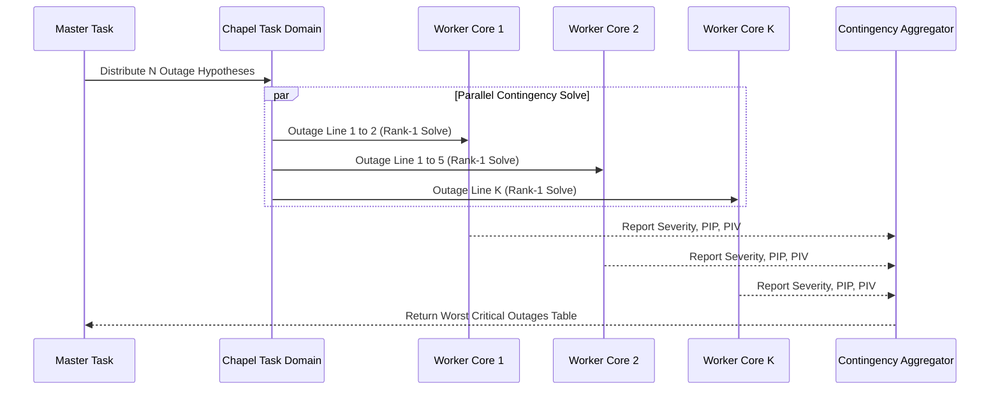
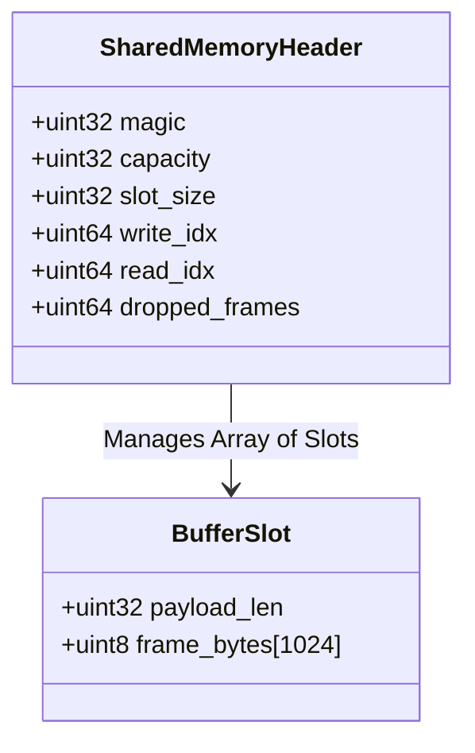
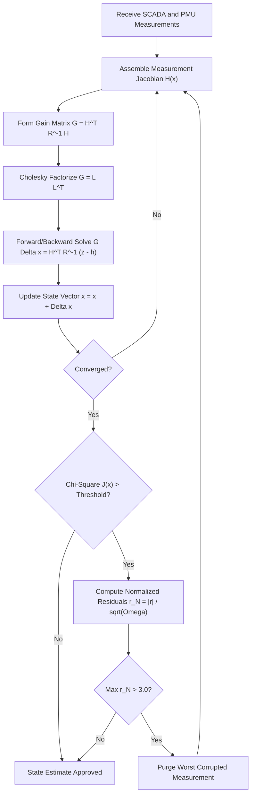

# Phasor System Architecture and Engineering Design

This document details the software architecture, concurrency model, memory layouts, and subsystem interactions of the Phasor Energy Management System (EMS).

---

## 1. System Overview and Layered Topology

Phasor is structured as a modular, cache-conscious high-performance computing kernel implemented in Chapel, with C hardware acceleration for table-driven CRC calculation and POSIX shared-memory packet bridging, and Python tooling for telemetry emulation and live visualization.

```mermaid
flowchart TD
    subgraph Ingestion["Telemetry and Ingestion Layer"]
        C37["IEEE C37.118 Decoder (C and Chapel)"]
        COMTRADE["IEEE C37.111 COMTRADE Parser"]
        RAW["PSS/E RAW 30/33 Network Ingester"]
        SHM["POSIX Zero-Copy Shared Memory Ring"]
    end

    subgraph DataModel["Unified Grid Data Model"]
        Net["PowerNetwork Container"]
        BusMod["Bus Nodes (Slack, PV, PQ)"]
        BranchMod["Transmission Branches and Transformers"]
        GenMod["Synchronous Machines and Cost Curves"]
        LoadMod["ZIP Polynomial Loads"]
    end

    subgraph LinearAlgebra["Sparse Linear Algebra Subsystem"]
        CSR["SparseCSR (Real and Complex SpMV)"]
        LU["Direct Sparse LU with Partial Pivoting"]
        Chol["Sparse Cholesky Factorizer"]
        SM["Sherman-Morrison Rank-1 Low-Rank Update"]
    end

    subgraph Solvers["Analytical and Numerical Solvers"]
        NR["Full AC Newton-Raphson Solver"]
        FDF["Fast Decoupled Load Flow (Stott-Alsac)"]
        DC["Linearized DC Power Flow"]
        WLS["Gauss-Newton WLS State Estimator"]
        Chi2["Chi-Square and Largest Residual Detector"]
        ContScreen["Parallel N-1/N-2 Contingency Screener"]
        RK4["Multi-Machine RK4 Transient Simulator"]
        SCED["Security-Constrained Economic Dispatch"]
    end

    subgraph Presentation["Telemetry Dashboard and Output"]
        CLI["Master CLI Executable"]
        ANSI["ANSI Telemetry Dashboard and Meters"]
        JSONExp["Structured JSON and CSV Exporters"]
        CursesUI["Live Python WAMS Dashboard"]
    end

    Ingestion --> DataModel
    DataModel --> LinearAlgebra
    LinearAlgebra --> Solvers
    Solvers --> Presentation
```



---

## 2. Concurrency and Parallel Distribution Model

Phasor exploits Chapel's multithreading and multi-locale distributed memory architecture:

### 2.1 Parallel Contingency Screening (`forall ... with (ref report)`)
Contingency evaluation across $K$ branches is inherently embarrassingly parallel. The engine distributes candidate outages across all available hardware threads using Chapel's work-stealing runtime.



### 2.2 Parallel Sparse Matrix-Vector Multiplication (SpMV)
Row-level parallelism distributes row intervals across processor cache lines without data race conditions:

$$\forall r \in [0, N): \quad y[r] = \sum_{k = \text{rowPtr}[r]}^{\text{rowPtr}[r+1] - 1} \text{values}[k] \cdot x[\text{colInd}[k]]$$

Each thread writes exclusively to its dedicated slice of vector $y$, ensuring zero lock contention and cache-line alignment.

---

## 3. High-Throughput Memory Layout and Zero-Copy Bridge

### 3.1 POSIX Shared Memory Ring Buffer
For high-frequency PMU streams arriving at 30 to 120 frames per second over UDP, standard OS context switching and network buffer copies become bottlenecks. Phasor implements a zero-copy POSIX shared memory ring buffer:



- **Power-of-Two Indexing**: Fast bitwise masking eliminates integer division overhead:
  $$\text{slot} = \text{write\_idx} \ \& \ (\text{capacity} - 1)$$
- **Memory Fencing**: Memory synchronization barriers (`__sync_synchronize()`) ensure sequential consistency between reader and writer processes without heavyweight mutex acquisition.

---

## 4. State Estimation Pipeline and Bad Data Rejection

The state estimation engine executes in an iterative loop:



---

## 5. Directory and Module Organization

```
phasor/
├── bin/                          # Compiled native binaries (phasor)
├── build/                        # Intermediate object files and libraries
├── benchmarks/                   # Micro and macro performance benchmarks
│   ├── bench_sparse_spmv.chpl
│   ├── bench_newton_raphson.chpl
│   └── bench_parallel_contingency.chpl
├── c_src/                        # C hardware acceleration sources
│   ├── phasor_fast_crc.c
│   ├── phasor_shared_mem.c
│   └── test_c_accel.c
├── data/                         # Standard IEEE and synthetic benchmarks
│   ├── ieee9.raw
│   ├── ieee14.raw
│   ├── ieee30.raw
│   ├── ieee57.raw
│   ├── ieee118.raw
│   └── synthetic_2000.raw
├── docs/                         # Exhaustive technical documentation
│   ├── ARCHITECTURE.md
│   ├── MATHEMATICAL_FORMULATION.md
│   ├── PMU_C37_118_SPECIFICATION.md
│   ├── CONTINGENCY_ANALYSIS_GUIDE.md
│   └── VERIFICATION_PASS.md
├── include/                      # C API public headers
│   └── phasor_c_api.h
├── python/                       # Telemetry bridge, emulator, and dashboard
│   ├── dashboard.py
│   ├── phasor_cli.py
│   └── pmu_stream_emulator.py
├── src/                          # Star Chapel kernel implementation
│   ├── Common/                   # Physical constants, types, and errors
│   ├── Math/                     # Sparse CSR, direct LU, Cholesky, Sherman-Morrison
│   ├── Grid/                     # Network topology, buses, branches, generators, loads
│   ├── Admittance/               # Y-Bus assembly, PTDF, and LODF sensitivities
│   ├── PowerFlow/                # Newton-Raphson, Fast-Decoupled, DC Power Flow
│   ├── StateEstimation/          # WLS, PMU linear estimator, Bad data processor
│   ├── Contingency/              # Outages, PI_P, PI_V, L-index, parallel screening
│   ├── Dynamics/                 # Multi-machine swing equations, RK4, COI, RoCoF
│   ├── Optimization/             # Economic dispatch, SCED, Interior Point Method
│   ├── Telemetry/                # C37.118 binary framer, COMTRADE, Ring Buffer
│   ├── IO/                       # RAW parser, ANSI dashboard, JSON/CSV exporters
│   └── Main.chpl                 # Unified CLI executable
├── tests/                        # Comprehensive unit and integration test suite (25+ tests)
└── tools/                        # Typography linter, test runner, benchmark runner
```
