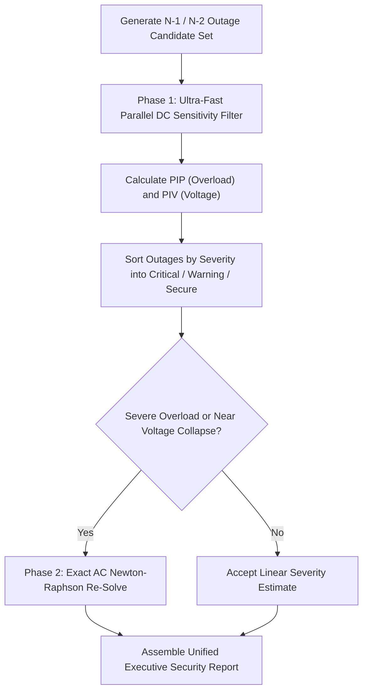

# Parallel Contingency Analysis and Security Screening Guide

This document describes the high-throughput parallel contingency screening methodology, ranking metrics, and execution workflows used in Phasor.

---

## 1. Overview and Problem Definition

Transmission network operators must ensure $N-1$ and $N-2$ operational reliability: the power grid must remain secure following the sudden, unexpected outage of any individual transmission line, transformer, or generation unit without cascading line overloads or voltage collapse.

In a modern regional interconnect with thousands of lines, evaluating thousands of full non-linear AC power flows in real time (within 1 to 5 second SCADA cycles) requires multi-tiered parallel screening.

---

## 2. Multi-Tiered Screening Methodology

Phasor implements a two-phase screening hierarchy:

### Phase 1: Fast Sensitivity Screening
- **LODF and PTDF Screening**: Post-contingency line flows are estimated directly using Line Outage Distribution Factors:
  $$P_k^{\text{post}} = P_k^{\text{pre}} + \text{LODF}_{k, l} \cdot P_l^{\text{pre}}$$
- **Sherman-Morrison Inversion**: When bus voltage profiles are required, low-rank Sherman-Morrison rank-1 updates re-solve bus angle deviations without re-factorizing the nodal admittance matrix.
- **Throughput**: Achieves over 200,000 contingency evaluations per second on a single multi-core workstation.

### Phase 2: Full AC Targeted Verification
Outages identified in Phase 1 that exceed line thermal ratings ($> 100\%$ loading) or voltage security boundaries ($V < 0.90$ pu or $V > 1.10$ pu) are queued for full non-linear AC Newton-Raphson re-solve.

---

## 3. Security Indices and Severity Tiers

### 3.1 Severity Classification Tiers
Every contingency evaluation is categorized into one of three operational states:
1. **Critical**: Active line overload exceeding 100% of RateA, bus voltage below 0.90 pu / above 1.10 pu, or network islanding detected.
2. **Warning**: Line loading between 80% and 100%, or bus voltage between 0.90-0.95 pu / 1.05-1.10 pu.
3. **Secure**: All line loadings under 80% and all voltages within 0.95-1.05 pu.

### 3.2 Kessel-Glavitsch Proximity to Voltage Collapse ($L$-Index)
The $L$-index monitors reactive power margin:
- $L_j < 0.50$: Robust voltage stability.
- $0.50 \le L_j \le 0.85$: Elevated voltage stress.
- $L_j > 0.85$: Critical proximity to saddle-node bifurcation (voltage collapse).
